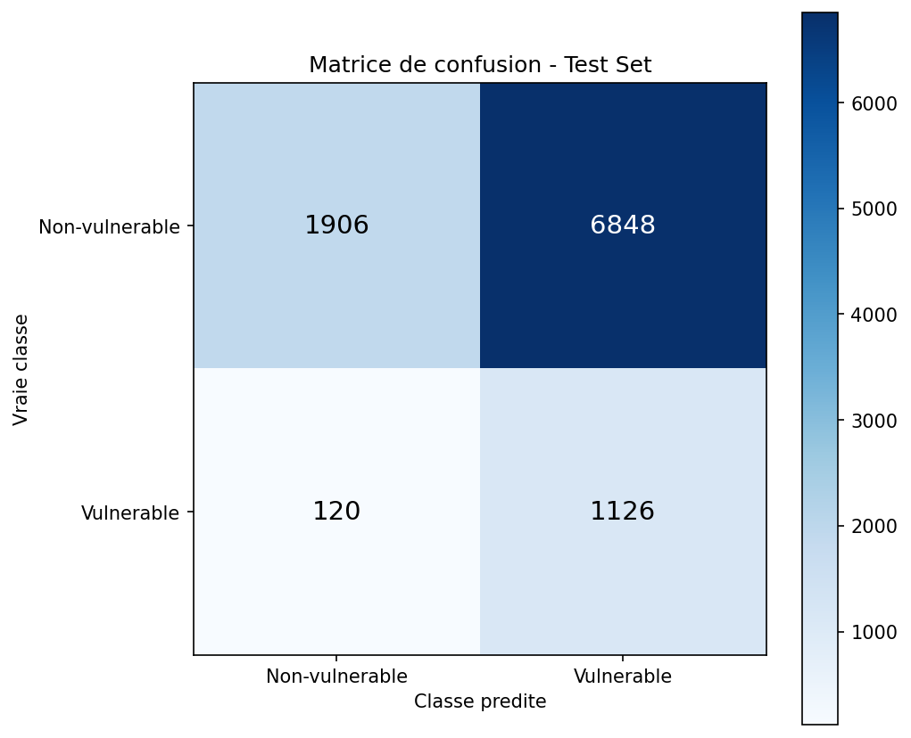

# 🛡️ Aegis VANGUARD — Détection de vulnérabilités par IA hybride

> Fine-tuning de **CodeBERT** pour détecter les fonctions vulnérables dans du code source, couplé à une couche de **vérification par LLM** pour filtrer les faux positifs et proposer des correctifs.

Projet de Master *Sécurité Informatique & Intelligence Artificielle* — année 2025–2026.


---

## Le problème

Plus de 25 000 CVE sont publiées chaque année. Les outils SAST classiques (SonarQube, Checkmarx, Fortify) reposent sur des règles syntaxiques : beaucoup de faux positifs, peu de compréhension du contexte, et une maintenance lourde à chaque nouvelle classe de faille.

**Idée :** utiliser un modèle de langage pré-entraîné sur du code pour apprendre directement à reconnaître une fonction vulnérable, puis confier la validation fine à un LLM.

## Architecture

```
 Code source ──► Data Layer ──► CodeBERT fine-tuné ──► Seuil θ = 0.45 ──► LLM (vérification) ──► Alerte + explication + patch
                 (extraction,     (classification        (privilégie        (confirme / infirme,
                  nettoyage,       binaire sûr /           le rappel)         CWE, correctif)
                  tokenisation)    vulnérable)
```

| Étage | Rôle | Choix |
|---|---|---|
| **CodeBERT** | « Tamis grossier » à haute sensibilité | `microsoft/codebert-base` (RoBERTa, 125 M paramètres), Focal Loss |
| **Seuil** | Favoriser le rappel : mieux vaut une fausse alerte qu'une faille ratée | θ = 0.45 au lieu de 0.50 |
| **LLM** | « Expert » qui filtre les faux positifs et génère le correctif | Prompt structuré (confirmation, type CWE, code corrigé) |

## Démarche et résultats

Le projet a été mené en deux phases, avec des itérations sur le dataset et la fonction de perte.

### Phase 1 — Defectors (Python)

Dataset [Defectors](https://doi.org/10.5281/zenodo.7708984) (MSR 2023) : ~213 000 extraits de code Python issus de 25 projets open source, étiquetés via l'algorithme SZZ.

| Run | Accuracy | Précision | Rappel | F1 |
|---|---|---|---|---|
| Baseline (cross-entropy, 3 époques) | 52,2 % | 17,2 % | 74,0 % | 0,28 |
| v2 (Focal Loss) — matrice de confusion ci-dessous | 30,3 % | 14,1 % | 90,4 % | 0,24 |

<p align="center">
  
</p>

### Phase 2 — DiverseVul (C/C++)

Passage à [DiverseVul](https://github.com/wagner-group/diversevul) : ~350 000 fonctions C/C++ liées à de vrais CVE, plus diversifié en types de vulnérabilités (CWE). Entraînement sur Colab avec **Focal Loss** (α = 5 sur la classe vulnérable, γ = 2), **sous-échantillonnage** de la classe majoritaire et **padding dynamique**.

| Métrique (step 3000) | Valeur |
|---|---|
| Rappel | 81,8 % |
| Précision | 10,7 % |
| Accuracy | 62,9 % |
| AUC | ≈ 0,80 |

### Lecture honnête des résultats

- **Le rappel est élevé** : le modèle laisse passer peu de vraies vulnérabilités, ce qui est la priorité pour un outil de sécurité.
- **La précision brute est faible** : le dataset est très déséquilibré (~5–10 % de fonctions vulnérables dans DiverseVul) et le seuil est volontairement bas. Utilisé seul, CodeBERT génère beaucoup de faux positifs.
- C'est précisément ce qui justifie l'**architecture hybride** : CodeBERT trie à grande échelle, le LLM valide les alertes. Le gain de précision apporté par le LLM reste à mesurer sur un jeu de test annoté (voir *Perspectives*).
- La détection de vulnérabilités à partir du code seul est une tâche difficile : dans la littérature, les meilleurs modèles spécialisés restent autour de 0,45–0,63 de F1.

## Contenu du dépôt

```
├── notebooks/
│   ├── 01_codebert_defectors_baseline.ipynb          # Phase 1 : premier fine-tuning
│   ├── 02_codebert_defectors_v2.ipynb                # Phase 1 : courbes, matrice de confusion
│   └── 03_codebert_diversevul_focal_loss_colab.ipynb # Phase 2 : DiverseVul, Focal Loss, seuil optimal
├── app/
│   └── app.py              # API Flask + interface web (POST /analyze)
├── results/                # Courbes d'entraînement et matrice de confusion
└── docs/
    ├── rapport_aegisvanguard.pdf            # Rapport complet (33 pages)
    └── presentation_phase1_defectors.md     # Présentation de la phase 1
```

> Les poids du modèle (~500 Mo) et les datasets tokenisés ne sont pas versionnés (limite GitHub de 100 Mo par fichier).

## Lancer le projet

**Entraînement** — ouvrir `notebooks/03_codebert_diversevul_focal_loss_colab.ipynb` dans Google Colab avec un GPU T4 et exécuter les cellules dans l'ordre. Le notebook télécharge DiverseVul, tokenise, entraîne, cherche le seuil optimal sur le test set et exporte le modèle.

**Application web** — placer le modèle entraîné dans `app/codebert_vuln_model/`, puis :

```bash
pip install -r requirements.txt
cd app && python app.py
# → http://localhost:5000
```

```bash
curl -X POST http://localhost:5000/analyze \
  -H "Content-Type: application/json" \
  -d '{"code": "def run(data): eval(data)"}'
# Réponse : {"score": <probabilité>, "defective": <true|false>, "label": "DEFECTUEUX" | "NORMAL"}
```

## Limites et perspectives

- Modèle centré sur C/C++ (phase 2) ; extension à Python, Java, JavaScript.
- Analyse au niveau de la fonction : pas encore de localisation ligne par ligne.
- Mesurer quantitativement l'apport de la couche LLM sur un jeu de test annoté.
- Classification par type de CWE, et non seulement vulnérable / sûr.
- Tester des encodeurs plus récents (UniXcoder, GraphCodeBERT) et l'oversampling / data augmentation.
- Intégration CI/CD (GitHub Actions) pour scanner chaque pull request.

## Équipe

| Membre | Contribution |
|---|---|
| **Aymane Ibn El Qorchy** | Étude comparative des datasets (Defectors, Devign, PrimeVul, DiverseVul), prétraitement et tokenisation, documentation |
| **Aymane Merbouh** | Architecture IA, entraînement CodeBERT (Focal Loss), analyse des résultats |
| **Yassine Boujida** | Extension VS Code, API backend, déploiement |

L'extension VS Code et la couche de vérification LLM décrites dans le rapport ne font pas partie de ce dépôt.

## Références

- Feng et al., *CodeBERT: A Pre-Trained Model for Programming and Natural Languages*, EMNLP 2020
- Chen et al., *DiverseVul: A New Vulnerable Source Code Dataset for Deep Learning Based Vulnerability Detection*, RAID 2023
- Mahbub et al., *Defectors: A Large, Diverse Python Dataset for Defect Prediction*, MSR 2023
- Lin et al., *Focal Loss for Dense Object Detection*, ICCV 2017
